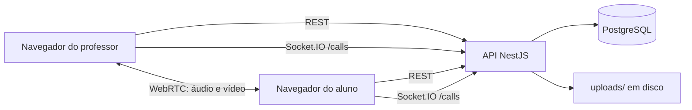
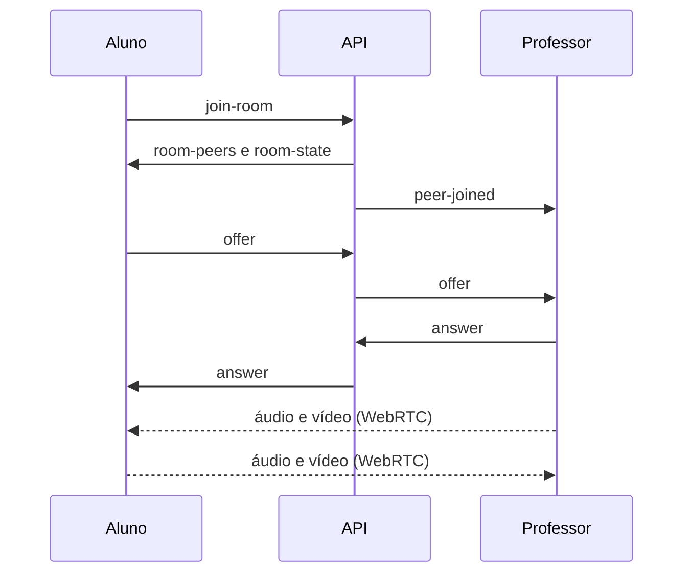

# Arquitetura

Retrato do código em novembro de 2026. Os problemas citados aqui têm etapa definida no [roteiro](ROTEIRO.md).

## Visão geral



Áudio e vídeo vão direto entre os navegadores (WebRTC em malha). Além do REST, a API troca os sinais de conexão e mantém sincronizados o livro, a lousa e o chat.

## Monorepo

| Caminho           | Conteúdo                                         |
| ----------------- | ------------------------------------------------ |
| `apps/api`        | NestJS 11, Prisma 6, Socket.IO                   |
| `apps/web`        | Next.js 16, React 19, Tailwind 4, pdf.js         |
| `packages/shared` | Tipos compartilhados; hoje nenhum app os importa |

As tarefas são executadas com Turborepo e pnpm workspaces.

### API

| Módulo     | Responsabilidade                                      |
| ---------- | ----------------------------------------------------- |
| `auth`     | Cadastro, login, refresh token, guards de JWT e papel |
| `users`    | Perfil e consulta de usuários                         |
| `classes`  | Turmas e livros                                       |
| `sessions` | Aulas (REST) e sala em tempo real (gateway)           |
| `prisma`   | Acesso ao banco                                       |

### Web

| Caminho em `apps/web/src`   | Responsabilidade                                           |
| --------------------------- | ---------------------------------------------------------- |
| `lib/api.ts`                | Cliente HTTP e sessão em `localStorage`                    |
| `lib/socket.ts`             | Conexão Socket.IO                                          |
| `lib/useWebRTC.ts`          | Mídia, conexões entre participantes, chat e estado da aula |
| `lib/useBook.ts`            | Livro e lousa sincronizados                                |
| `components/BookViewer.tsx` | Renderização do PDF e camada de desenho                    |
| `app/session/[id]`          | Sala de aula                                               |
| `app/classes/[id]`          | Turma e livros                                             |

## Modelo de dados

```mermaid
erDiagram
  User ||--o| Teacher : "é"
  User ||--o| Student : "é"
  User ||--o{ RefreshToken : possui
  Teacher ||--o{ Class : leciona
  Teacher ||--o{ Session : conduz
  Class ||--o{ Enrollment : tem
  Student ||--o{ Enrollment : tem
  Class ||--o{ Session : agenda
  Class |o--o{ Book : usa
```

Uma `Session` é uma aula, com estado `SCHEDULED`, `LIVE`, `ENDED` ou `CANCELLED`.

O schema também tem `ClassSchedule`, `Assignment`, `AssignmentSubmission` e `Payment`, sem uso nos apps e fora do [escopo](ESCOPO.md).

## Rotas REST

Prefixo `/api/v1`. O Swagger fica em `/api/docs`.

| Rota                                  | Acesso hoje                                | Acesso desejado                         |
| ------------------------------------- | ------------------------------------------ | --------------------------------------- |
| `POST /auth/register`                 | Público                                    | Público, com limite de requisições      |
| `POST /auth/login`                    | Público                                    | Público, com limite de requisições      |
| `POST /auth/refresh`                  | Quem tem o refresh token                   | Igual, com limite de requisições        |
| `POST /auth/logout`                   | Quem tem o refresh token                   | Igual                                   |
| `GET /users/me`                       | Usuário logado                             | Igual                                   |
| `GET /users`                          | `ADMIN`                                    | Igual                                   |
| `GET /users/:id`                      | **Qualquer usuário logado** (expõe e-mail) | Próprio usuário ou `ADMIN`              |
| `POST /classes`                       | `TEACHER`                                  | Igual                                   |
| `GET /classes/my`                     | `TEACHER`                                  | Igual                                   |
| `GET /classes/enrolled`               | `STUDENT`                                  | Igual                                   |
| `GET /classes/:id`                    | **Qualquer usuário logado**                | Professor da turma ou aluno matriculado |
| `POST /classes/:id/books`             | Professor da turma                         | Igual                                   |
| `GET /classes/:id/books`              | Professor da turma ou aluno matriculado    | Igual                                   |
| `GET /classes/:id/books/:bookId/file` | Professor da turma ou aluno matriculado    | Igual                                   |
| `GET /classes/:classId/sessions`      | **Qualquer usuário logado**                | Professor da turma ou aluno matriculado |
| `POST /sessions`                      | Professor da turma                         | Igual                                   |
| `GET /sessions/:id`                   | **Qualquer usuário logado**                | Professor da turma ou aluno matriculado |
| `PATCH /sessions/:id/start`           | Professor da aula                          | Igual                                   |
| `PATCH /sessions/:id/end`             | Professor da aula                          | Igual                                   |

A verificação desejada já existe: `canAccessClass`, em `apps/api/src/classes/classes.service.ts`.

## Eventos de socket

Namespace `/calls`, autenticado com o access token na conexão.

### Do navegador para a API

| Evento                                              | Quem pode hoje                                                      | Efeito                          |
| --------------------------------------------------- | ------------------------------------------------------------------- | ------------------------------- |
| `join-room`                                         | Professor da aula ou aluno matriculado, se a aula não foi cancelada | Entra na sala                   |
| `leave-room`                                        | Qualquer conectado                                                  | Sai da sala                     |
| `offer`, `answer`, `ice-candidate`                  | **Qualquer conectado**                                              | Repassa o sinal ao destinatário |
| `session-started`, `session-ended`                  | Professor da aula                                                   | Muda o estado da aula           |
| `book-open`, `book-page`, `draw-clear`, `pen-grant` | Professor na sala                                                   | Controla livro, lousa e caneta  |
| `draw-stroke`                                       | Na sala: professor ou quem tem a caneta                             | Desenha                         |
| `chat-message`                                      | **Qualquer conectado**                                              | Envia mensagem à sala informada |

Os itens em negrito devem passar a exigir que o remetente esteja na sala. Nos sinais, o destinatário também.

### Da API para o navegador

`room-peers`, `room-state`, `peer-joined`, `peer-left`, `offer`, `answer`, `ice-candidate`, `session-live`, `session-finished`, `book-page`, `draw-stroke`, `draw-clear`, `pen-grant`, `chat-message` e `error`.

### Entrada na sala



Quem entra liga para quem já está na sala. A troca de `ice-candidate` foi omitida do diagrama. Este é o fluxo projetado: um problema em `lib/socket.ts` (tarefa 2.2) provavelmente impede que ele se complete hoje.

## Decisões

| Decisão                                  | Motivo                                                                          | Consequência                                         |
| ---------------------------------------- | ------------------------------------------------------------------------------- | ---------------------------------------------------- |
| Vídeo em malha, sem servidor de mídia    | Simples e sem custo para turmas pequenas                                        | Cada participante envia o vídeo para todos os outros |
| Estado da sala na memória da API         | Suficiente para uma instância                                                   | Some ao reiniciar; não permite várias instâncias     |
| Traços em coordenadas relativas à página | Alinham em qualquer tamanho de tela                                             | O cliente recalcula as posições ao desenhar          |
| PDF servido por rota autenticada         | Só a turma acessa o livro                                                       | O navegador baixa o arquivo com o token              |
| Token em `localStorage`                  | Permite sessão por aba na demo planejada; cookies são compartilhados entre abas | Exposto a XSS; limite conhecido                      |

## Limites conhecidos

- Só há STUN: em algumas redes o vídeo não conecta sem TURN.
- PDFs ficam no disco da API, e muitas hospedagens apagam esse disco a cada deploy.
- O upload de até 50 MB passa pela memória da API.
- O cliente não renova o access token, que expira em 15 minutos.
- O `ThrottlerModule` está configurado, mas sem guard, portanto não limita nada.
